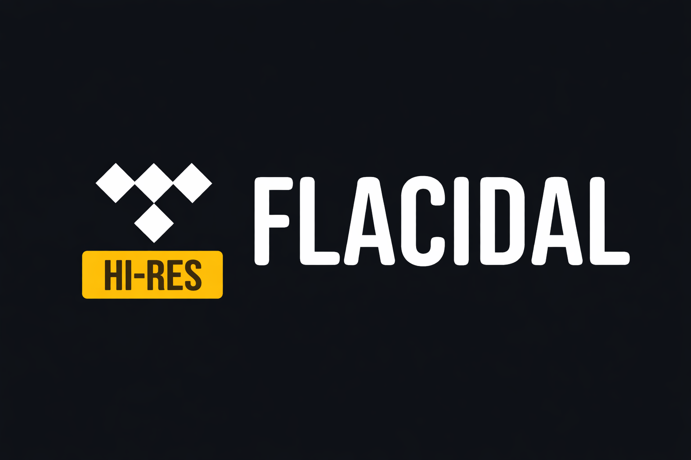
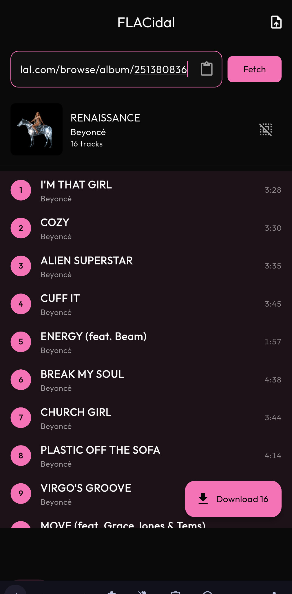
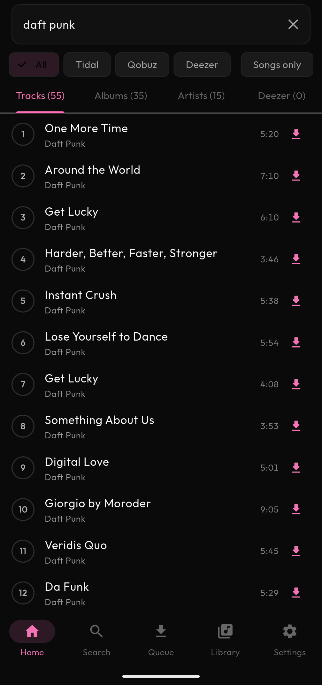
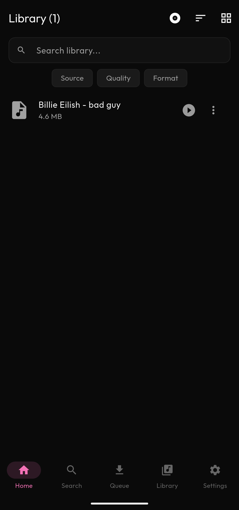
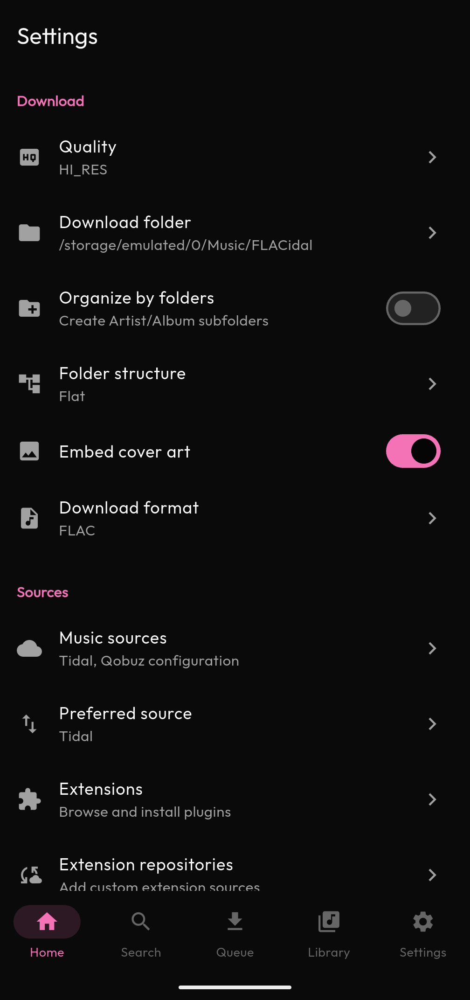
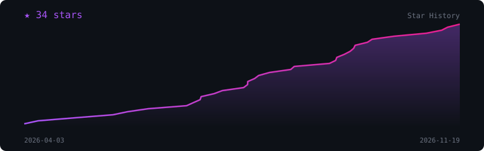

<div align="center">



### FLACidal Mobile

**Grab lossless FLAC tracks from Tidal & Qobuz straight onto your phone**

[](https://github.com/kushiemoon-dev/flacidal-mobile/releases/latest)
[](https://github.com/kushiemoon-dev/flacidal-mobile/stargazers)
[](LICENSE)
[](https://flutter.dev)
[](https://go.dev)


</div>

---

<div align="center">




</div>

---

## Overview

**FLACidal Mobile** is the on-the-go counterpart to [FLACidal Desktop](https://github.com/kushiemoon-dev/FLACidal). Drop in a Tidal URL, pick your tracks, and Hi-Res or Lossless FLAC lands straight on your device, no account needed.

Flutter handles the UI, while a shared Go backend reached through FFI drives the entire download pipeline.

---

## Features

- **Hi-Res & Lossless** audio, up to 24-bit/192 kHz straight from Tidal and Qobuz
- **Paste & Download**: drop in any Tidal URL, whether it's an album, playlist, track, or artist page
- **URL Resolution** auto-resolves links from other platforms to Tidal through Odesli
- **Search** lets you switch providers and sort results while browsing Tidal and Qobuz
- A **Real-time Queue** showing download speed, ETA, and per-track percentage live
- **Background Downloads**: a foreground service keeps transfers going even after the app is closed
- A **Library** with albums grouped by disc number, filterable by source/quality/format, and "Already in Library" flagging
- **Metadata Editing** right in the app, covering title, artist, album, composer, genre, ISRC, and more
- **Cover Art** extraction, saving embedded artwork as a standalone .jpg
- **Lyrics** support: grab synced or plain lyrics, embed them in the FLAC, or export as .lrc
- **Re-enrich** to refresh and re-embed metadata without touching the audio again
- Complete **MP3 Tagging**: ID3v2 tags including cover art, lyrics, and composer
- **Singles/Albums Folders**: singles and albums sort into separate folders automatically
- An **Extension System** for adding community extensions that pull in more music sources
- A **Custom Theme** matching the desktop app's dark theme, with the Outfit font and accent color options
- **Share Intent**: share a Tidal link from your browser and downloading starts right away

---

## Download

**[Download Latest APK](https://github.com/kushiemoon-dev/flacidal-mobile/releases/latest)**

| Platform | File | Install |
|----------|------|---------|
| Android 7.0+ | `FLACidal-<version>-arm64.apk` (or `universal`) | Direct install, or add this repository as a source in [Obtainium](https://github.com/ImranR98/Obtainium) |
| iOS | `FLACidal.ipa` (unsigned) | Sideload with AltStore or SideStore, source: `https://raw.githubusercontent.com/kushiemoon-dev/flacidal-mobile/main/altstore/apps.json` |

Releases also ship a `checksums.txt` with the SHA256 of every APK.

F-Droid is not planned.

### Upgrading from the beta

1.0 is signed with a new release key, so Android cannot install it over a beta
(`INSTALL_FAILED_UPDATE_INCOMPATIBLE`). Do this once:

1. In the beta, open **Settings > About > Export config** and keep the file.
2. Uninstall the beta.
3. Install 1.0, then use **Import config**. Tidal, Soulseek and Qobuz
   credentials are redacted in exports and must be entered again.

From 1.0 on, updates install in place. The in-app updater detects this case and
shows these steps instead of trying to install.

---

## Usage

1. Launch **FLACidal Mobile**
2. Drop in a Tidal URL (or share one straight from your browser)
3. Pick your tracks and hit **Download**
4. Files land in `Music/FLACidal/` on your device

### Supported Content

| Source | Types |
|--------|-------|
| **Tidal** | Album · Playlist · Track · Mix · Artist |
| **Qobuz** | Album · Playlist · Track |
| **Other** | Any music URL (resolved via Odesli) |

---

## Architecture

```
flacidal-mobile/         Flutter app
├── lib/
│   ├── core/            FFI bridge + URL resolver
│   ├── pages/           14 screens
│   ├── widgets/         8 reusable components
│   ├── providers/       Riverpod state management
│   ├── theme/           Custom dark theme
│   └── router/          GoRouter navigation
│
flacidal-core/           Shared Go backend (compiled as .so/.a)
```

The Go backend handles networking, downloads, metadata, and storage, while Flutter takes care of the UI. The two talk to each other via JSON-RPC over FFI.

---

## Build from Source

**Requirements:** Flutter 3.41+, Go 1.26.5+, Android NDK r29 (`ndk;29.0.14206865`)

`libflacidal.so` is not stored in git. `CORE_VERSION` pins the Core tag
(`v0.31.0` or newer); the build script refuses any other checkout.

```bash
# 1. Check out the pinned Core tag and build the three ABIs into jniLibs
git -C ../flacidal-core checkout "$(cat CORE_VERSION)"
tool/build_core.sh ../flacidal-core

# 2. Build the Flutter APK
flutter build apk --release
```

A release build needs a signing key: provide `android/key.properties`
(`storeFile`, `storePassword`, `keyAlias`, `keyPassword`) or the
`ANDROID_KEYSTORE_PATH`, `ANDROID_KEYSTORE_PASSWORD`, `ANDROID_KEY_ALIAS` and
`ANDROID_KEY_PASSWORD` environment variables. Debug builds need neither.
Without the libraries the build stops with an explicit message; use
`-Pflacidal.abis=arm64-v8a` to require a single ABI during development.

### iOS (requires macOS + Xcode)

```bash
cd flacidal-core
make ios
cp build/ios/libflacidal.a build/ios/libflacidal.h ../flacidal-mobile/ios/Runner/

cd ../flacidal-mobile
flutter build ipa --no-codesign
```

The Xcode project force-loads `ios/Runner/libflacidal.a`; the release workflow
checks that `FlacInit` is present in the built app.

---

## Configuration

| Setting | Default | Options |
|---------|---------|---------|
| Quality | `LOSSLESS` | `HI_RES` · `LOSSLESS` · `HIGH` |
| Format | `FLAC` | `FLAC` |
| Folder structure | Flat | By Artist/Album · By Playlist · Flat · Singles/Albums |
| Theme | Dark | Dark · Light · System |
| Accent color | Pink | 12 presets |
| Font | Outfit | 16 options |

---

## FAQ

**Do I need a Tidal account?**
Nope, FLACidal handles authentication on its own.

**Where are files saved?**
On Android: `/storage/emulated/0/Music/FLACidal/`, and it's configurable from Settings.

**Is iOS supported?**
Releases include an unsigned IPA that you sideload with AltStore or SideStore. It is built by the iOS workflow on a macOS runner and has not been tested on a device by the maintainer.

**Can I convert files to other formats?**
Not on Android: FFmpeg is not bundled, and the convert screen says so instead of failing.

**Why do I have to reinstall to get 1.0?**
See [Upgrading from the beta](#upgrading-from-the-beta).

**Does it work in the background?**
It does: a foreground service keeps downloads going while the app sits minimized.

---

## Contributing

Contributions are welcome. Here's where extra hands would help most:

- **iOS testing**: the unsigned IPA is built in CI only; reports from real devices are very welcome.
- **Bug reports**: file an issue with steps to reproduce.

---

## Star History

[](https://github.com/kushiemoon-dev/flacidal-mobile/stargazers)

---

## Disclaimer

FLACidal Mobile exists strictly for **personal and educational purposes**. It has no affiliation with, endorsement from, or connection to Tidal, Qobuz, or any other streaming service. Making sure your usage stays within local laws and each platform's Terms of Service is entirely on you. The software is provided "as is" without warranty of any kind.

---

<div align="center">

**MIT License** · [Desktop App](https://github.com/kushiemoon-dev/FLACidal) · [Releases](https://github.com/kushiemoon-dev/flacidal-mobile/releases)

Built with ♥ by [KushieMoon](https://github.com/kushiemoon-dev)

</div>
